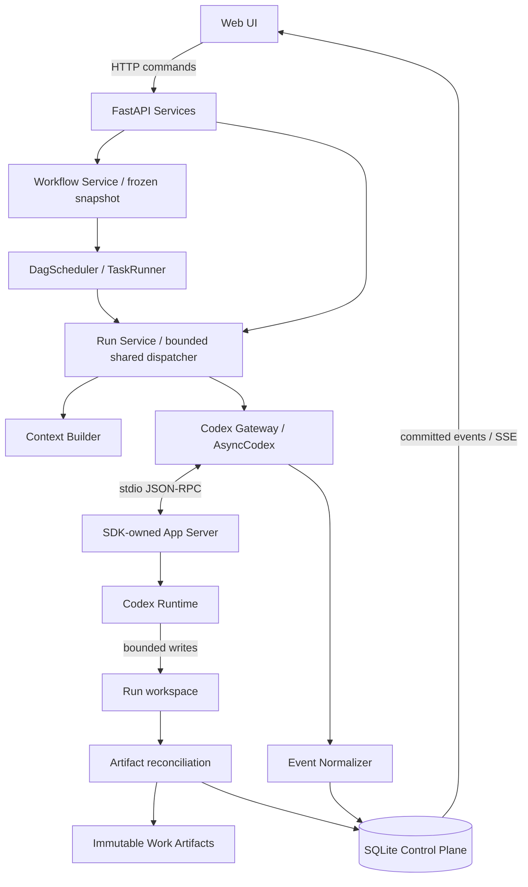

# AI Project Control Center Architecture

> Workspace/Storage의 우선 기준: [control-center-workspace-storage-requirements.md](control-center-workspace-storage-requirements.md).
> 최초 설계: 2026-09-28. 현행 구현 반영: 2026-09-29 (Phase 1~4). Phase 4 기준은 [phase4-requirement.md](phase4-requirement.md), 변경사항과 검증 범위는 [최종 리뷰](phase4-final-review.md)를 참조한다.
> 근거: [현재 Phase 1 요구사항](phase1-requirements.md), [실측 Runtime Capabilities](runtime-capabilities.md).
> SDK/App Server 요구사항이 들어 있는 `phase1-requirements.md`를 기준으로 삼았다.


## Product Principles

Control Center는 사용자가 Codex의 내부 명령어나 Runtime 개념을
직접 알아야 하는 부담을 줄이는 것을 기본 원칙으로 한다.

### 1. 사용자가 명령어를 외우게 하지 않는다
사용자는 `/compact`, `fork`, `resume`, cron 같은 내부 명령을 몰라도 된다.

화면에는 사용자가 이해하기 쉬운 행동으로 표시한다.

예:
- 대화 정리 → `정리해서 계속하기`
- 분기 → `이 지점에서 분기`
- 기존 대화 재개 → `이 대화에서 계속하기`
- 실행 중 방향 수정 → `현재 작업에 추가 지시`
- 작업 중단 → `작업 중지`
- 스케줄 설정 → `실행 일정`

내부 구현은 Codex SDK나 Scheduler 기능을 사용한다.


### 2. 모든 대화를 계속 쌓지 않는다
이전 대화와 자료를 무조건 다음 실행에 모두 넣지 않는다.

현재 작업에 필요한 자료만 골라서 전달한다.

예:
Phase 4를 구현할 때 Phase 1의 테스트 로그 전체가 필요하지 않다면 넣지 않는다.

긴 대화를 계속 유지하는 것보다,
현재 목표와 중요한 결정만 정리해서 새 Thread로 넘기는 방식을 우선한다.


### 3. 대화는 임시 작업공간으로 본다
중요한 정보를 대화 안에만 남겨두지 않는다.

오래 보관해야 하는 내용은 다음 형태로 저장한다.

- 결과물 → Artifact
- 중요한 결정 → Decision
- 반복해서 사용할 지식 → Knowledge
- 작업 규칙 → Policy
- 반복 작업 방법 → Skill

대화가 삭제되거나 새 Thread로 바뀌어도
프로젝트의 중요한 상태가 사라지지 않아야 한다.


### 4. 사용자 프로젝트 폴더를 지저분하게 만들지 않는다
Control Center가 관리하기 위해 필요한 파일을
사용자의 기존 프로젝트 폴더에 함부로 생성하지 않는다.

예:
기존 프로젝트에 다음 폴더를 강제로 추가하지 않는다.

- artifacts/
- context/
- runs/
- decisions/

Control Center 전용 데이터는 별도 관리 경로에 저장한다.

사용자 Workspace에는 실제 프로젝트 파일만 유지한다.


### 5. AI끼리 결과를 넘길 때 정확한 대상을 지정한다
다음 AI에게 "이전 결과를 알아서 찾아라"라고 시키지 않는다.

어떤 Task의 어떤 결과물을 입력으로 사용할지
Backend가 명시적으로 연결한다.

예:

Task B
→ market-review.md 생성

Task D Input
→ Task B의 market-review.md

이 관계를 DB에도 기록한다.

### 6. 내부 명령어는 숨기되 사용자의 제어권은 줄이지 않는다

사용자가 Codex SDK 함수명이나 CLI 명령어를 알 필요는 없다.

하지만 작업 흐름에 영향을 주는 선택은 사용자가 직접 조절할 수 있어야 한다.

예:
- 같은 대화를 계속할지
- 현재 지점에서 분기할지
- 새 대화로 정리해서 넘길지
- 질문용 임시 대화를 만들지
- 언제 실행할지
- 반복 실행할지
- 어떤 자료를 다음 작업에 전달할지
- 결과를 폐기할지 저장할지

Control Center는 이런 선택을 자동으로 숨기지 않는다.

대신 사용자가 이해하기 쉬운 UI로 제공한다.

### 7. 기술 용어는 줄이되 필요한 작업 개념은 유지한다

사용자에게 필요한 개념까지 없애려고 하지 않는다.

예를 들어 다음 개념은 실제 작업 제어에 중요하므로
UI에서 명확하게 구분할 수 있어야 한다.

- 계속하기
- 분기하기
- 새 대화로 넘기기
- 질문하기
- 자료 선택
- 실행 일정
- 반복 실행
- 결과 저장
- 결과 폐기

반대로 Thread ID, Turn ID, Cron 표현식,
Context Pack ID 같은 구현 세부사항은 기본 UI에서 숨긴다.

목표는 "개념을 없애는 것"이 아니라
"사용자가 내부 구현을 몰라도 세밀하게 조작할 수 있게 하는 것"이다.


## develop

## 1. 결정과 범위

기본 실행 경로는 **FastAPI → Codex Gateway → 공식 `openai-codex` Python SDK → 로컬 Codex App Server(stdio JSON-RPC)**로 확정한다. SDK `0.158.0`과 동봉 Runtime `0.158.0`, Python 3.10 이상을 기준으로 한다. 현재 검증 Python은 3.10.2다. 패키지/Runtime을 함께 고정하고 업그레이드 시 capability probe를 재실행한다.

SDK가 App Server 자식 프로세스를 관리하는 것은 정상적인 기본 경로다. 요청별 `codex exec` subprocess를 띄우는 설계와 구별한다. 주요 요구 기능이 SDK로 검증되었으므로 `codex exec` fallback은 구현하거나 활성화하지 않는다. SDK 상위 API가 부족하면 Gateway 내부에서 공개 low-level SDK/App Server RPC를 먼저 검토한다. `_client`, `_sync` 등 SDK private 속성에는 의존하지 않는다.

현재 FastAPI, UI, SQLite migration, Run pool, DAG scheduler, Artifact 서비스와 Phase 2의 Workflow·Library·Template이 구현되어 있다. Phase 3의 Approval, 예약 실행, Pause / Resume, Checkpoint와 Delayed Resume, Phase 4의 Thread Lifecycle·Query·Context Pack·Handoff·Promotion이 기존 실행 경로 위에 구현되어 있다. Runtime 실측 근거와 FakeGateway 기반 애플리케이션 검증은 구분한다.



## 2. 프로세스와 실행 소유권

- FastAPI는 로컬 단일 프로세스, 단일 Uvicorn worker로 운영한다. 개발 hot reload 중 실행 지속을 보장하지 않는다.
- Backend lifespan에서 `AsyncCodex(CodexConfig(...))`를 한 번 초기화하고 종료 시 닫는다. SDK가 stdio App Server를 시작하고 handshake와 notification routing을 담당한다.
- Run Service가 실행 task를 소유한다. HTTP 응답/SSE 연결의 수명과 실행 수명을 분리한다. 브라우저 연결 종료로 Turn을 취소하지 않는다.
- 전체 실행은 `CONTROL_CENTER_MAX_PARALLEL_TASKS`(기본 3)의 공유 슬롯을 사용한다. Phase 1 standalone 요청끼리는 lane 1/FIFO를 유지하고, Workflow Task는 남은 슬롯에서 병렬 실행한다. 슬롯은 준비부터 최종 파일 확정까지 점유한다.
- Runner의 `owned_threads`와 DB의 queued/active 검사가 같은 Thread의 중복 시작을 차단한다. 작업 경로는 Backend가 Run ID로 생성하여 분리하고, Workflow 명령/finalizer는 `COMMAND_LOCK`, 관리 Git 작업은 `GIT_LOCK`으로 직렬화한다. 별도 범용 경로 잠금 서비스는 없다.
- 중복 Backend 기동은 process lock으로 차단한다. SQLite의 실행 소유권/조건부 UPDATE도 함께 적용한다. 향후 병렬화를 위해 분산 큐를 미리 도입하지 않는다.

## 3. Codex Gateway 계약

서비스/UI에는 SDK 타입이나 Raw JSON-RPC를 노출하지 않는다. Gateway가 아래 도메인 계약을 제공한다.

| 계약 | 검증된 SDK 경로 | 책임 |
| --- | --- | --- |
| initialize / close | `AsyncCodex` async context | Runtime 버전, 연결 epoch, health 관리 |
| account_status | `account()` | `account.type`, 연결 여부 반환; 이메일/토큰 로깅 금지 |
| list_models | `models()` | 모델/Reasoning/default/pagination을 도메인 DTO로 변환 |
| create_thread | `thread_start(...)` | Thread ID를 Run에 연결 |
| resume_thread | `thread_resume(id, ...)` | 같은 Thread 대화 맥락 복원; 새 Run 준비 |
| read_thread | `AsyncThread(...).read(include_turns=True)` | 복구 시 저장된 Turn과 상태 조회 |
| start_turn | `thread.turn(input, effort=...)` | handle의 Thread/Turn ID 반환 |
| stream_turn | `handle.stream()` | 하나의 reader task에서 이벤트 수신/정규화 |
| steer | `handle.steer(text)` | expected Turn ID가 고정된 실행 중 입력 |
| interrupt | `handle.interrupt()` | 중단 요청; ACK와 실제 종료를 구분 |

`handle.run()`과 `handle.stream()`을 한 handle에서 동시에 소비하지 않는다. UI를 위한 최종 응답은 stream의 agentMessage items에서 조립한다. 모델 실패/중단/transport 손실은 서로 다른 도메인 오류로 변환한다. 알 수 없는 notification은 method와 호환성 경고만 남기고 Run을 완료 처리하지 않는다.

모델 목록은 Runtime에서 매번 갱신 가능한 캐시로 제공한다. `nextCursor`가 있으면 공개 low-level `model/list`로 나머지 페이지를 조회한다(이번 응답은 null). 선택 모델과 effort가 현재 반환 목록에 있는지 검증한다. 기본값도 목록의 `isDefault`와 `defaultReasoningEffort`에서 가져온다. 요청 값과 실제 확인 가능한 Runtime 값을 별도 저장하며, 목록에 있다고 모든 모델/effort 조합이 실측된 것으로 표시하지 않는다.

인증은 기존 사용자 Codex 인증 저장소를 재사용한다. `CODEX_HOME`을 임의로 새 폴더로 바꾸거나 자격 증명을 복사하지 않는다. API Key는 기본 요구사항이 아니다. `requiresOpenaiAuth=true`는 로그아웃 판정 조건이 아니다. 이번 테스트에서도 account가 ChatGPT인 상태에서 true였다.

미로그인 시 공식 SDK의 `login_chatgpt()`로 login handle/URL을 제공하고 완료 후 account를 재조회하는 확장점을 둔다. 이 API의 존재는 확인했지만 새 OAuth 로그인은 이번에 실행하지 않았다. 출시 전 별도 수용 테스트가 필요하다. UI의 Connected는 계정 존재/Runtime health를 뜻하며 무제한 사용 가능을 뜻하지 않는다. 토큰 만료·사용량 한도 오류는 별도로 표시한다.

## 4. 로컬 저장 구조와 소유권

Workspace/Storage 요구사항을 우선 적용한다. 새 Work는 외부 Workspace를 연결하며 Application 내부 `data/categories/.../works/...`를 새로 만들지 않는다. Category는 논리적 분류이며, 생성 위치를 `~/Developer/<category>`로 지정하면 Category 하위 Workspace도 만들 수 있다.

```text
~/Developer/AI_Contol_Center/          # Application
  app/, docs/, tests/
  data/shared/global/<artifact-id>/
  data/shared/category/<category-id>/<artifact-id>/
~/Developer/<workspace>/             # 실제 사용자 자료
  docs/, src/, ...
  outputs/<run-id>/<output-path>      # 실행으로 생성한 결과, Run별 분리
~/.control-center/                   # 신규 설치의 DB/metadata 기본 위치
  control.db, backend.lock, manifests/
<system temporary>/control-center-runtime-<instance>/
  <work-id>/runs/<run-id>/inputs/
  <work-id>/runs/<run-id>/workspace/  # ARTIFACT_ONLY cwd
  <work-id>/runs/<run-id>/worktree/   # GIT_WORKTREE cwd
  <work-id>/runs/<run-id>/outputs/
  <work-id>/git/repository.git/
```

기존 설치에 Application 내부 `.control-center-state/control.db`가 있으면 그 DB를 그대로 사용한다. `CONTROL_CENTER_STATE/DATA/WORKSPACE_ROOT/RUNTIME`로 경로를 지정할 수 있다. 기존 `data`와 Work 파일은 이동·삭제·자동 전환하지 않는다. schema `0004`는 위치 metadata 열만 추가하고 기존 row의 경로를 유지한다.

새 Work의 `storage_layout=EXTERNAL`, `workspace_path`는 실제 폴더다. 기존 Work는 `LEGACY`이며 기존 `path`를 계속 해석한다. Workspace 변경은 사용자 명령으로만 이루어지고 파일을 복사하지 않는다. 기존 Source/Artifact는 원래 위치를 읽는다. 활성/결과 불명 실행이 있으면 연결 변경을 거절한다.

기존 폴더 연결 자체는 `work.json`, `AGENTS.md`, `context`, `runs`, `.control-center` 등을 생성하지 않는다. 문서 생성·자료 업로드·실행 결과 저장은 사용자가 요청한 작업에서만 수행한다. 새 Markdown은 지정한 Workspace 상대경로에 생성하며 기존 파일은 덮어쓰지 않는다. `AGENTS.md`는 사용자가 문서 종류를 명시한 경우에만 생성한다.

Source는 `WORKSPACE/EXTERNAL`의 파일 참조 또는 이전 `LEGACY` 파일이다. Artifact는 `WORKSPACE/SHARED/EXTERNAL` location, 저장 root/상대경로/hash를 가진 결과 객체이며 이전 `LEGACY` Artifact도 읽는다. 실행 결과는 Workspace `outputs/<run-id>/`에 보관한다. Category/Global Publish를 사용자가 요청하면 검증된 bytes를 `data/shared/`로 복사하고 같은 Artifact ID를 유지한다. Workspace 원본은 유지하며 해당 새 실행의 임시 후보 파일만 삭제한다. 예전 Publication은 자동 복사하지 않고 기존 저장 위치로 호환된다.

SQLite는 제어 상태의 원본, 파일 시스템은 bytes의 원본이다. Runtime 쓰기는 Run별 임시 cwd/output으로 제한하며 연결 프로젝트·DB·Shared Library를 직접 쓰게 하지 않는다. Git 모드는 기존 관리 clone/worktree와 patch 수집을 재사용한다. 자동 Merge/원본 프로젝트 덮어쓰기는 수행하지 않는다.

## 5. Context Manifest

Context Builder는 선택 자료를 실행 전에 읽어 snapshot으로 고정하고, 정확히 전달한 입력을 저장한다. Global/Category/Work/Request의 선택 출처를 구분한다. 단순 파일 경로 목록만 기록하지 않는다.

Manifest 필수 내용:

- schema version, Run/Request/Work ID, 생성 시각.
- 사용자 instruction 원문과 hash, 실제 조립한 prompt/hash.
- 선택 파일별 source ID, scope, 원래 상대 경로, snapshot 경로, SHA-256, 크기, MIME, 전달 방식.
- 텍스트 발췌/추출 시 원본 hash와 추출 결과 hash, 생략/크기 제한, 추출기 버전.
- model/effort 요청값, SDK/Runtime 버전, cwd, sandbox/approval 설정.
- AGENTS/운영 규칙 snapshot hash. Runtime이 자동 참조하는 사용자 설정/skills까지 완전히 동결했다고 주장하지 않는다.
- Resume의 parent Run/Thread ID와 새로 추가한 Context. Steer 입력은 별도 instruction revision 이력에 연결.

```json
{
  "schema_version": 1,
  "run_id": "run_002",
  "parent_run_id": "run_001",
  "thread_id": "runtime-thread-id",
  "instruction_sha256": "sha256-of-input",
  "model_requested": "runtime-selected-id",
  "effort_requested": "runtime-selected-effort",
  "files": [{
    "source_id": "src_001",
    "scope": "work",
    "original_path": "context/architecture.md",
    "snapshot_path": "runs/run_002/inputs/architecture.md",
    "sha256": "sha256-of-snapshot-bytes",
    "size": 1024,
    "delivery": "local_path_reference"
  }]
}
```

Backend가 snapshot을 생성한 뒤 그 경로를 prompt에 명시한다. local path 전달은 모델이 실제로 파일 전체를 읽었다는 증거가 아니다. Manifest는 **제공된 Context**의 기록이다. 도구 이벤트로 관측된 읽기 활동은 별도 기록하며, 내부 모델 Context의 완전한 추적이나 결정론적 재현성을 보장하지 않는다. PDF/이미지 등은 지원 입력/추출기를 별도 검증한 뒤 전달하고, 실패를 조용히 누락하지 않는다.

Resume에서는 기존 Thread history가 함께 들어온다. 따라서 현재 선택 자료만이 전체 Context라고 표시하지 않는다. Thread를 다른 Work로 이동시키지 않으며 새 Run의 cwd/권한을 명시적으로 다시 적용한다. 과거 경로는 읽을 수 있더라도 쓰기는 새 workspace로 제한한다.

## 6. DB 모델

SQLite + SQLAlchemy + Alembic을 사용하며 foreign keys, WAL, busy timeout을 적용한다. 모델 실행 중 DB transaction을 열어두지 않는다.

| Entity | 핵심 필드 / 관계 |
| --- | --- |
| Category | id, name, active, created_at |
| Work | category_id, id, stable_path, name, description, archive/provision state |
| Source | work_id 또는 global/category scope, relative_path, MIME, hash, size |
| Request | work_id, instruction, 선택 Context IDs/revision, created_at |
| Run | request_id, work_id, parent_run_id, thread_id, turn_id, model/effort, manifest, status, execution_phase, timestamps, error |
| Artifact | work_id, run_id, immutable relative_path, original_candidate_path, MIME, size, SHA-256, availability |
| Event | autoincrement id, run_id, thread_id, turn_id, item_id, type, payload, observed_at, connection_epoch, origin |
| RunInstruction | run_id, revision, text, requested_at, accepted_at, target_turn_id, delivery_state/error |

Run에는 `operation`(new/retry/resume), `runtime_terminal_status`, `dispatch_state`, `cancel_requested_at`, `backend_epoch`, `artifact_state`도 둔다. `(thread_id, turn_id)`는 turn_id가 있을 때 unique로 강제한다. 이는 같은 Turn을 두 Run에 잘못 연결하는 것을 감지하는 최후 방어선이며, 시작 전 잠금을 대신하지 않는다.

새 Request의 첫 실행과 Retry는 기본적으로 새 Thread를 만든다. Retry는 이전 실행 결과를 되돌리지 않는 새 Run이며, 기존 대화를 이어가려면 사용자가 Resume를 선택한다. 같은 Request의 재실행에서도 Run별 Manifest는 불변으로 남긴다. 사용자 instruction을 변경하면 새 Request revision과 새 Run으로 기록한다.

HTTP 명령 idempotency key는 Work/operation 범위에서 unique하게 저장한다. 같은 key의 POST 재전송은 기존 Run ID를 반환한다. Phase 2는 별도 WorkflowRun/TaskRun에 생성 명령 key/hash를 보존한다.

## 7. Run 상태와 실행 흐름

요구사항의 공개 상태를 유지한다. 실행/복구 세부 단계는 `execution_phase`로 분리한다.

```text
CREATED ── dispatch accepted ──> RUNNING ── terminal + reconciliation ──> COMPLETED
   │                              ├──────────────────────────────────> FAILED
   └─ cancelled before dispatch ──┴─ confirmed interruption ─────────> CANCELLED
```

- `CREATED`: DB에 기록되었고 대기/Context 준비 중. Start HTTP는 이 시점에 `202 + run_id` 반환.
- `RUNNING`: Runtime이 Turn을 수락한 상태. phase는 `EXECUTING`, `CANCEL_REQUESTED`, `FINALIZING`, `RECOVERING`으로 구분.
- `COMPLETED`: Runtime `completed` 확인과 결과 파일 reconciliation 완료. 결과 파일이 0개인 텍스트 작업도 정상이다.
- `FAILED`: Runtime failed 또는 Backend 준비/복구 오류. `error.code`로 Runtime 실패, Artifact 저장 실패, 결과 불명 등을 구분.
- `CANCELLED`: dispatch 이전 취소 또는 Runtime `interrupted` 확인. cause는 user_cancel/backend_shutdown/runtime_interruption으로 구분.

실행 순서:

1. Request/Run/Context 선택을 commit하고 Run ID를 반환한다.
2. dispatcher가 실행 슬롯과 Thread/Work 잠금을 확보한다. Context snapshot/manifest/cwd를 준비한다.
3. thread_start 또는 thread_resume 후 Thread ID를 즉시 commit한다. 첫 Thread에는 사용자 요청을 보내기 전 로컬 Run 연결 정보를 보존한다.
4. `dispatch_state=SUBMITTING`을 commit한 뒤 `thread.turn()` 호출. 수락된 Turn ID를 저장하고 `RUN_STARTED`와 상태 변경을 한 transaction으로 commit한다.
5. 단일 reader가 SDK stream을 소비한다. 초기에 들어온 이벤트는 handle의 subscription에서 소비하며, DB 매핑이 끝나기 전에 UI로 흘려보내지 않는다.
6. terminal을 수신하면 Runtime 결과를 먼저 영속화하고 `FINALIZING`으로 이동한다. Artifact 검사/등록 후 Run terminal 상태와 표준 terminal event를 commit한다.

Turn RPC와 SQLite 사이에는 원자적 commit이 없다. Start 전후에 프로세스가 죽으면 결과가 불명일 수 있다. `SUBMITTING` 상태를 자동 재전송하지 않는다. 아래 복구 정책을 따른다.

### Steer

현재 Run/Turn이 active인지 확인한 뒤 instruction revision을 `PENDING`으로 commit하고 `handle.steer`를 호출한다. ACK의 Turn ID가 일치하면 `ACCEPTED`. ACK는 모델이 지시를 완전히 수행했다는 뜻은 아니다. terminal과 경쟁하여 `no active turn to steer`가 오면 `REJECTED`/HTTP 409로 처리하고 새 Turn을 몰래 만들지 않는다. transport 손실 시 `DELIVERY_UNKNOWN`이며 자동 재전송하지 않는다. 이미 실행된 명령/파일 변경을 되돌리는 기능으로 표시하지 않는다.

### Cancel

아직 dispatch되지 않은 `CREATED` Run은 바로 취소한다. Start가 진행 중이면 cancel intent를 기록하고 Turn ID 확인 후 interrupt한다. 실행 중에는 `cancel_requested_at` 및 phase만 갱신하고 interrupt ACK `{}`만으로 `CANCELLED`를 확정하지 않는다.

`turn/completed.status=interrupted`가 취소 완료 기준이다. cancel과 자연 완료가 경합하면 실제 terminal status가 우선한다. timeout/transport 손실은 `RECOVERING`으로 보내고 상태를 조회한다. 중단 전 파일/외부 효과는 rollback되지 않는다. SDK task 취소나 프로세스 kill을 정상 Cancel 구현으로 사용하지 않는다.

## 8. Event → Store → SSE

Frontend는 Control Center event만 처리한다. Gateway에서 thread/turn/item 식별자를 보존하여 상관관계를 유지한다.

| 실측 Runtime 신호 | 표준 Event / 처리 |
| --- | --- |
| `turn/started` 또는 수락된 handle | `RUN_STARTED` (한 번만) |
| agentMessage started/delta/completed | `ACTIVITY` (commentary/final 구분) |
| item started: commandExecution | `COMMAND_STARTED` |
| item completed: commandExecution | `COMMAND_COMPLETED`, exit code/output |
| item completed: fileChange | 파일 존재/경로 검증 후 `FILE_CHANGED` |
| `turn/diff/updated` | 파일 재검사 힌트; Artifact 존재 증거로 사용하지 않음 |
| 파일 scan으로 발견한 변경 | `FILE_CHANGED`, origin=filesystem_scan |
| protocol/runtime warning/error | `WARNING`, 필요 시 Run error |
| turn completed: completed/failed/interrupted | reconciliation 후 `RUN_COMPLETED` / `RUN_FAILED` / `RUN_CANCELLED` |

`fileChange`는 notification method 이름이 아니라 item의 type이다. started 상태는 제안일 수 있고 completed도 실패/거절 여부를 확인한다. command의 완료 이벤트가 오지 않고 Turn이 중단되는 경우를 실측했다. 이 경우 command 결과를 성공으로 채우지 않는다.

- event insert와 해당 Run 상태 변경을 동일 SQLite transaction으로 commit한 뒤 SSE로 전달한다.
- SSE `id`는 Backend Event ID이다. `Last-Event-ID` 이후 저장 이벤트를 재생하고 heartbeat를 보낸다. 브라우저는 ID로 중복 제거한다.
- Runtime stream은 이 SSE cursor를 이해하지 않는다. Runtime 재연결로 과거 delta 전체가 재생된다고 가정하지 않는다.
- Item lifecycle/terminal 중복은 Runtime ID로 억제한다. text delta는 동일 문구가 반복될 수 있으므로 내용 hash만으로 중복 제거하지 않는다. connection epoch + 수신 sequence를 기록한다.
- text delta는 작은 시간/크기 단위로 묶어 저장할 수 있다. terminal은 앞선 buffer를 flush한 다음 저장한다. crash 시 미commit delta 손실 가능성을 명시한다.
- 느린 SSE subscriber는 연결을 끊고 DB cursor 재접속으로 복구한다. Runtime reader가 느린 브라우저를 기다리지 않게 한다.
- reasoning/raw chain-of-thought는 DB와 SSE 모두 저장·노출하지 않는다. allowlist DTO를 사용하며, unknown/raw payload와 인증 stderr 전체를 그대로 보관하지 않는다.

## 9. Artifact 후보, 확정, Preview

AI의 최종 텍스트나 `fileChange`만으로 Artifact를 등록하지 않는다. 실제 테스트에서 Shell redirect로 파일이 생겼지만 `fileChange`는 없었다.

1. Run workspace baseline을 기록한다. fileChange/command 완료를 재검사 힌트로 사용하고 실행 중 제한적인 scan을 수행한다.
2. `workspace/artifacts/`의 파일을 결과 후보로 취급한다. project 작업 사본의 변경은 UI에서 별도 변경 내역/patch 후보로 제공한다. 모든 scratch 파일을 자동 결과물로 게시하지 않는다.
3. terminal 시 최종 scan은 필수다. path resolve + root containment + symlink 검사 후 일반 파일 존재/크기/hash를 확인한다. FIFO/device 및 root 밖 symlink는 거절한다. 읽기 전후 stat이 변하면 재시도하거나 불안정 후보로 남긴다.
4. 안정된 바이트를 Work `artifacts/<run-id>/` 임시 파일로 복사하고 hash 확인 → atomic rename → Artifact row commit. 파일 이동과 DB commit 사이 crash는 reconciliation으로 복구한다. `(run_id, path, hash)`로 중복 등록을 방지한다.
5. 기존 등록한 Artifact hash는 변경하지 않는다. Workspace 파일이 바뀌면 availability 검사로 감지하며, Shared 복사본은 기존 hash와 다르면 덮어쓰지 않는다. Resume는 새 Run 경로에 새 Artifact를 만든다. 취소/실패 Run의 부분 결과는 partial로 구분해 보존한다.

Artifact row에는 availability를 둔다. 사용자가 로컬 파일을 지우거나 바꾸면 `MISSING`/`MODIFIED`를 표시하며 과거 hash를 조용히 갱신하지 않는다. DB 오류/용량 부족으로 확정 실패하면 `artifact_state=ERROR`; Runtime 성공과 제품 Run 실패 사유를 각각 보존한다.

Preview는 Backend가 Artifact ID를 실제 경로로 해석한다. Markdown은 sanitize, text/code는 escape, 이미지는 허용 MIME/크기로 제한한다. HTML/JS를 앱 origin에서 실행하지 않으며 일반 파일은 다운로드로 제공한다. UI가 임의 절대 경로를 Backend에 보내 읽게 하지 않는다.

## 10. Sandbox와 권한

Runtime 프로세스가 자신의 `~/.codex`에 기록할 권한과, 모델이 실행하는 도구의 Sandbox는 서로 다른 경계다. 이번 에이전트의 외부 샌드박스에서는 App Server 초기화가 막혔지만, 정상 로컬 프로세스로 시작하면 Runtime Sandbox의 쓰기 제한은 동작했다.

Gateway는 thread_start/resume/fork에 Run의 ExecutionProfile이 선택한 `Sandbox`와 `ApprovalMode.deny_all`, canonical cwd를 명시한다. 기본 Permission은 `workspace-write`다. `read-only`도 선택할 수 있다. SDK의 `full-access`는 공통 Profile과 과거 기록 해석에 남아 있지만, Phase 3의 Approval / Schedule / control DB 보호 원칙에 따라 신규 실행과 대기 Run dispatch에서는 거절한다. Runtime 지원 여부와 앱에서 허용하는 실행 권한을 구분한다. 자동 권한 확대는 허용하지 않고, 거절된 작업을 WARNING/error로 표시한다. 향후 Permission Inbox는 별도 Runtime request handler로 추가하며 Run/Workflow 상태와 혼합하지 않는다.

Workspace Write의 쓰기 범위는 새 Run workspace로 제한하고, `sandbox_workspace_write` 설정의 `writable_roots=[]`, `network_access=false`, `exclude_tmpdir_env_var=true`, `exclude_slash_tmp=true`를 사용한다. `/tmp` 예외가 Control DB 보호를 우회하지 않도록 제외한다. 세밀한 policy 필요 시 Gateway 내부의 공개 App Server API를 사용한다. Turn에서 단순 `sandbox=Sandbox.workspace_write`를 매번 덮어쓰면 preset 기본 policy가 적용될 수 있으므로, 시작/Resume에서 설정한 정책을 유지하거나 완전한 policy를 전달한다.

이 thread config로 실제 모델 명령의 cwd 내부 쓰기와 외부 dummy DB 쓰기 차단을 확인했다([증거](runtime-evidence/hardened-retry.json)). 첫 시도는 명령 실행 자체가 없어서 성공으로 판정하지 않았다. network_access=false의 실제 네트워크 차단과 Resume 후 경계 재검증은 구현 Gate에 포함한다.

Control DB, manifests, inputs, 확정 Artifacts는 cwd 및 writableRoots 밖에 둔다. `AGENTS.md` 문구만으로 보호했다고 주장하지 않는다. workspace-write는 읽기 격리를 보장하지 않으므로 다른 로컬 파일의 기밀성 경계로 설명하지 않는다. 악의적인 도구/MCP/plugin 전체를 격리하는 별도 OS 계정/컨테이너는 이번에 검증하지 않았다. MVP Gateway는 임의 plugin/tool 승인이나 원격 노출을 활성화하지 않는다.

Backend HTTP는 loopback에 bind하고 상태 변경 API에 session token/Origin 검사를 적용한다. 모델 자식 shell에는 Backend session secret을 상속시키지 않는다. 임의 cwd/경로/쉘 명령 API를 UI에 노출하지 않는다. 이 HTTP 보호는 `app/main.py`에 구현되어 있으며 offline API 회귀 테스트로 확인한다.

## 11. Backend 재시작과 복구

영속 보존 대상은 Category/Work/Request/Run/Artifact/Event/Manifest/Steer 이력이다. `asyncio.Task`, SDK handle, 프로세스 ID는 영속 상태가 아니다. Codex Thread history는 별도 Codex 저장소가 소유하며 `control.db` 백업만으로 복구되지 않는다.

### 정상 종료

새 dispatch를 멈추고 활성 Run에 종료 intent를 기록한다. interrupt → terminal 수신/commit → Artifact reconciliation → SDK close 순서로 마무리한다. 제한 시간 안에 종료되지 않으면 `RECOVERING`을 남긴다. SDK close가 실행 중 Turn을 끊을 수 있으므로 close를 먼저 호출하지 않는다.

### 시작 시 reconciliation

1. Backend lock을 획득하고 migration/DB 및 경로 무결성을 확인한다. 미확정 파일 이동/Artifact 등록을 복구한다.
2. 이전 `CREATED/SUBMITTING/RUNNING/FINALIZING/RECOVERING` Run을 조회한다. 이전 PID만 보고 활성이라고 판단하거나 무조건 실패 처리하지 않는다.
3. 새 App Server에서 **먼저 저장된 Thread/Turn을 읽는다**. read는 모델 실행을 시작하지 않는다. 정확한 Turn ID가 있으면 그 상태를 우선 사용한다.
4. persisted completed/failed/interrupted를 확인하면 각각 대응 terminal로 정리한다. interrupted 원인은 cancel intent가 없으면 runtime_interruption으로 남긴다. terminal event는 중복 생성하지 않는다. Artifact 최종 scan을 재실행한다.
5. 저장되지 않은 실시간 delta는 되살리지 않는다. history의 completed items로 최종 화면을 보완할 때 origin=runtime_history로 구분하고 `WARNING: event gap`을 기록한다.
6. Thread/Turn 누락, 오래된 inProgress, 응답 timeout 등은 결과 불명이다. 이전 프로세스 소유권/종료 여부를 확인할 수 없으면 해당 Thread/Work 실행 잠금을 유지하고 충돌 실행을 막는다. 확인 불가 상태를 성공/취소로 꾸미지 않는다.
7. 복구가 끝나도 terminal을 증명할 수 없으면 `FAILED` + `RUNTIME_OUTCOME_UNKNOWN`을 남기며 수동 확인/새 Run Resume 선택을 제공한다. Unknown은 모델이 아무 일도 하지 않았다는 뜻이 아니다.

`SUBMITTING`에서 Turn ID 저장 전에 죽는 경계에는 exactly-once 보장이 없다. Thread history의 이전 Turn 목록/입력/시각을 비교하되 유일한 연관성을 확인할 수 있을 때만 연결한다. 모호하면 자동 Start 재시도를 금지한다. 아직 dispatch하지 않은 CREATED만 안전하게 다시 queue한다.

명시적 Resume는 기존 Run을 부활시키지 않는다. 새 Run을 만들고 parent_run_id를 기록한 다음 기존 Thread를 resume하여 새 Turn을 실행한다. 같은 Work인지 확인하고 새 Context/cwd/권한을 적용한다. 다른 계정이나 Codex 저장소로 바뀌어 Thread가 없으면 명확한 오류를 표시한다.

실측 범위: SDK/App Server를 닫은 후 새 인스턴스에서 완료/중단 history 조회와 후속 Turn이 성공했다. 실제 FastAPI crash, SIGKILL, OS 재부팅, orphan process 정리는 아직 미검증이다. 프로세스가 살아 있는 채 Backend만 재연결하는 daemon/WebSocket 구조는 채택하지 않는다.

## 12. 구현 순서와 검증 Gate

1. 버전 고정, Gateway/auth/model 조회, 최소 DB/Run/Event store 구현.
2. 단일 dispatcher, idempotency/Thread lock, SSE replay, Steer/Cancel race 처리.
3. Work/Context snapshot/Manifest, bounded Run workspace, Artifact reconciliation/Preview.
4. Request/Run/Artifact 화면과 명시적 Resume.
5. 실제 Backend 재시작/Start ACK 직후 crash/Artifact rename 직후 crash/SSE 재접속 수용 테스트.

SDK 실측 성공을 Phase 1 전체 수용 기준 통과로 대체하지 않는다. 새 OAuth 로그인, 인증 만료/한도, 다른 모델·effort 조합, 장시간 대용량 이벤트, 미검증 프로세스 종료 경계는 구현 단계의 Gate다. Runtime patch upgrade도 같은 probe와 경계 테스트를 통과해야 한다.

## 13. 이후 확장 위치

- Additional Runtime: Codex Gateway와 동일한 도메인 계약의 adapter를 추가하고 capability로 UI 기능을 제한.
- 예약 Scheduling 확장: 구현된 ONE_TIME / RECURRING occurrence와 기존 Engine 인계 계약을 유지하면서 예약 정책을 확장. Request/Run/Thread 식별 관계와 Event Store는 유지.
- Shared Library/Artifact Handoff: 구현된 수동 publish/handoff 계층을 확장. immutable Artifact와 Manifest hash를 유지.
- Instruction Patch: 기존 Instruction 이력과 구현된 Task Branch/Fork 정책을 확장. Branch는 별도 단일 Task WorkflowRun이며 Resume와 구별.
- Permission UI: Gateway server-request handler와 별도 permission record에 추가. 지금은 deny 정책.

공식 인터페이스 참고: [Codex Python SDK](https://learn.chatgpt.com/docs/codex-sdk), [Codex App Server](https://learn.chatgpt.com/docs/app-server). 현재 버전의 로컬 실측과 설치된 SDK 소스가 위 결정의 직접 근거다.


## 14. Phase 2 구현 경계와 파일 배치

| 모듈 | 현재 책임 |
| --- | --- |
| `workflow.py`, `workflow_api.py` | 정의/revision/DAG 검증, 불변 snapshot, Retry/Branch, Library/Template/Source import API |
| `scheduler.py`, `task_runner.py` | 최신 attempt 기준 준비/실패 집계, Run 원자적 연결, Output Contract·lineage |
| `runner.py`, `run_service.py` | 공유 pool, standalone lane, Turn/Thread 소유권, cancel/recovery/finalizer |
| `execution.py`, `workspace.py` | Source/Artifact 입력 사본, hash/manifest, 안전한 파일 읽기와 확정 복사 |
| `git_workspace.py` | LINKED 원본 읽기, 관리 bare clone, Run별 detached worktree, patch/ZIP 수집 |
| `artifact_service.py` | 확정 output slot 검증, 수동 공개 범위, Library 목록/Artifact 관계 |
| `static/workflows.js` | 정의 폼, 실행/attempt, Branch, 항목별 Template 재선택, 독립 Workflow SSE |
| `storage.py`, `storage_api.py`, `static/storage.js` | 외부 Workspace/참조 location, 수동 문서/Artifact 등록, 최소 저장소 UI |

`storage.py`가 Workspace/Runtime/자료 location을 해석하고 `storage_api.py`가 명시적 생성·연결 변경·문서·외부 참조·Finder 명령을 제공한다. `storage_layout=LEGACY`에는 이전 `Work.path` 저장 구조를 유지하고, `EXTERNAL` 실행은 임시 Runtime root와 실제 Workspace를 분리한다. 실행 manifest는 당시 storage/workspace root를 고정한다.

Task COMPLETED는 Runtime completed, 필수 파일 검사, immutable Artifact/slot/lineage 등록이 모두 성공한 뒤 기록한다. 필수 출력 누락은 Runtime 상태를 보존하면서 `OUTPUT_CONTRACT_FAILED`로 처리한다. 실패 downstream은 BLOCKED로 남으며 명시적인 Retry/포기/Cancel로 진행한다. Retry는 새 TaskRun/Run/Thread, Branch는 원본 revision에 기반한 별도 WorkflowRun을 만든다.

Event는 하나의 테이블에 Run/Workflow/Task scope를 저장한다. SQLite SELECT에도 명시적인 read transaction을 열어 상세 상태와 cursor를 같은 snapshot에서 읽는다. Run과 Workflow의 브라우저 stream/cursor는 각각 관리하며 선택 세대가 달라진 응답은 무시한다.

시작은 process lock → 필요한 upgrade 전 SQLite backup → migration/FK check → recovery → dispatcher 순서다. 스케줄러 예외는 로그와 `/api/health.dispatcher_error`에 노출하고 1초 후 다시 평가한다. 이는 모델 실행의 자동 Retry와는 별개이며 기존 실행 소유권을 유지한다.


## 15. 공통 Execution Settings

기준 문서는 [Execution Settings Requirements](execution-settings-requirements.md)다.
`app/execution_settings.py`의 `ExecutionProfile`과 Resolver를 모든 실행 진입점에서 재사용한다.

- 공통 필드: `model`, `reasoning`, `personality`, `permission`, `speed`.
- 상속: Runtime 기본값을 바탕으로 Global → Category → Work → Run / Task Override를 적용한다. 누락/null은 상속한다.
- `execution_defaults`는 범위별 sparse override를 저장한다. PUT에서 null/누락한 필드는 제거한다.
- TaskDefinition의 `execution_profile`은 override다. Workflow 시작 시 각 Task를 resolve해서 definition snapshot에 보관하고, Task enqueue / Retry는 그 snapshot으로 Run을 생성한다. Branch는 부모의 확정 profile에 새 override를 적용한다.
- Run의 `execution_profile`은 생성 시 확정한 전체 JSON snapshot이며 기존 `model` / `reasoning` 컬럼과 일치한다. 같은 snapshot을 Manifest와 Gateway에 전달한다. 대기/실행 중 기본값 변경으로 다시 resolve하지 않는다.
- 기존 Model / Reasoning API 필드는 호환 입력으로 수용한다. 공통 profile과 값이 충돌하면 거절한다. 기존 NULL profile Run / Task / Workflow snapshot은 원래 Model / Reasoning과 기존 Workspace Write 정책으로 해석한다. 이 해석을 위해 과거 row를 backfill하지 않는다.
- Model / Reasoning / 추가 Speed 등급은 Runtime 카탈로그로 검증한다. SDK의 `turn_service_tier="default"`는 표준 속도로 명시적으로 초기화하며 Resume/Fork의 이전 Fast 설정을 상속하지 않는다.
- SDK 0.158.0의 Personality 선택은 deprecated / 미지원이다. `personality=null`을 저장하고 선택 UI를 비활성화하며, 응답 스타일을 임의 프롬프트로 에뮬레이션하지 않는다.
- Permission은 Model과 독립적이다. SDK의 `read-only`, `workspace-write`, `full-access` 매핑을 유지하되, Phase 3에서 허용하는 실행은 Read Only / Workspace Write로 제한한다. Turn에서는 단순 Sandbox preset을 재전달하지 않아 Git Task의 추가 writable roots를 유지한다.
- Migration 0005는 defaults 테이블과 nullable Run / Task profile 컬럼만 추가한다. 기존 파일, Work, Run, Workflow를 변경하지 않는다.
- 단일 실행 / Retry / Resume / Task / Branch 화면에서 같은 설정 입력을 사용한다. 기본값 저장과 resolve preview는 기존 token/Origin 보호 아래 `/api/execution-settings`에 연결한다.
- Phase 4 Query / Handoff 및 향후 Review / Quick Action은 같은 Resolver와 `create_run(execution_profile=...)` 계약을 사용한다. 이번 변경은 해당 기능 자체를 추가하지 않는다.


## 16. Phase 3 Workflow 운영

기준 문서는 [phase3-requirements.md](phase3-requirements.md)다. Approval / Revision / 예약은 AI와
Codex Gateway를 직접 실행하지 않으며, 기존 Workflow Engine → DAG Scheduler → Run Service → Runner → Gateway를 사용한다.

### 승인과 Revision

- TaskDefinition에 `review_policy=AUTO | REVIEW_AFTER | APPROVAL_REQUIRED`를 저장하고 실행 snapshot으로 고정한다. 과거 snapshot의 누락 값은 AUTO다.
- TaskRun은 기존 실행 상태를 유지한다. 성공 Task는 승인 대기 중에도 COMPLETED다. 별도 `approvals`와 `artifact_reviews`가 human review 상태를 보관하며 ArtifactPublication과 분리한다.
- AUTO는 자동 진행, REVIEW_AFTER는 downstream을 막지 않는 사후 검토, APPROVAL_REQUIRED는 승인 전 dependency admission / enqueue / dispatch를 차단한다. 필수 승인만 남으면 WorkflowRun은 WAITING_APPROVAL이다.
- Inbox와 decision API는 현재 Task 시도 / Workflow cancellation을 확인하고 `BEGIN IMMEDIATE` + 공통 COMMAND_LOCK 안에서 상태를 변경한다. 동일한 decision digest 재요청은 기존 결과를 반환한다. 중복 승인으로 Task / Run을 추가 생성하지 않는다.
- Approve 전에 산출물 bytes/hash를 확인한다. 승인만 해서는 Publish되지 않는다. 미승인 / Reject / Revision 요청 결과물은 Publish할 수 없다. Approve & Publish는 review와 publication DB 상태를 한 transaction에서 변경하고 기존 Publish 파일 서비스를 재사용한다.
- Revision은 새 TaskRun과 execution override를 생성한다. downstream이 시작하지 않았다면 같은 Workflow에서 새 시도로 교체하고 소비자를 차단한다. REVIEW_AFTER 소비자가 이미 진행한 경우에는 별도 WorkflowRun으로 분기한다.
- 이전 Run / Artifact / 입력 binding을 덮어쓰지 않는다. 기존 출력과 고정 입력을 참조하고 새 Artifact에 REVISION_OF를 기록한다. Retry는 해당 시도의 override와 입력 hash를 유지한다.
- Reject는 Task 성공 기록을 바꾸지 않고 필수 승인의 downstream을 SKIPPED로 만들며 Workflow를 REJECTED로 집계한다. 이미 실행된 REVIEW_AFTER 소비자의 이력은 소급 취소하지 않는다.

### Pause / Resume와 Checkpoint

- Pause는 soft pause다. 이미 PREPARING / 실행 중인 Task는 정상 마무리하고 새 enqueue / QUEUED Run dispatch는 차단한다. `paused` 플래그와 PAUSED 표시 상태를 분리해 승인 / 실행 결과가 도착해도 Pause가 유지된다.
- Resume는 기존 Workflow의 미실행 DAG를 다시 진행한다. 기존 terminal Run을 RUNNING으로 되돌리지 않는다.
- `workflow_checkpoints`는 definition snapshot, Task 시도, 출력 Artifact ID/hash, review 상태, Manifest와 최종 응답을 저장한다. Pause와 Delayed Resume 요청 시 기록한다.
- Delayed Resume는 완료된 Task의 이어하기다. 필수 승인 Task는 먼저 승인되어야 한다. 미래 시각 또는 지연 시간을 입력하며 기존 Workflow 전체를 처음부터 반복하지 않는다.
- 지연 시각에 Checkpoint와 기존 고정 입력 / 출력으로 별도 WorkflowRun, TaskRun, Run을 생성한다. parent 관계와 `delayed_resume` operation, checkpoint_id를 남긴다. 대화 기억을 복원하거나 기존 Run을 부활시키지 않는다. 이전 AI 응답은 명시적인 reference data로만 전달한다.

### Schedule와 복구

- `workflow_schedules`는 ONE_TIME / RECURRING, UTC 시작 시각, 분 단위 고정 반복 간격, 공통 입력 선택, 활성 여부, misfire 정책을 저장한다. UI에 Cron 문법은 없다.
- Trigger는 현재 유효한 Workflow definition / Execution Settings / Context를 기존 Engine에서 freeze해 새 WorkflowRun을 생성한다.
- `(schedule_id, scheduled_for)` unique occurrence와 영속 CLAIMED 기록을 사용한다. 다음 시각 advance와 claim을 한 transaction에서 저장하고, WorkflowRun 생성 / occurrence의 TRIGGERED 연결도 한 transaction에서 저장한다. 재시작 후 claim과 idempotency key를 재사용한다.
- FIRE_ONCE는 놓친 여러 회차를 한 번으로 합치고 원래 anchor 기준의 다음 미래 시각으로 진행한다. SKIP은 지연이 grace_seconds를 초과한 회차를 기록하고 건너뛴다. backlog를 연속 모델 호출로 재생하지 않는다.
- 비활성화는 아직 Engine에 인계하지 않은 claim을 CANCELLED로 바꾼다. 이미 시작한 Workflow는 별도 Pause / Cancel로 제어한다. 반복 회차마다 새 WorkflowRun을 만들며 실행 슬롯은 기존 Run pool을 따른다.
- Runtime 미확정 상태 / 일시적 catalog 장애의 Schedule claim은 retry_at으로 대기한다. terminal trigger 오류는 FAILED와 error로 남긴다. Delayed Resume도 unknown Runtime outcome에 막히면 PENDING을 유지한다.
- Backend 시작 시 기존 Runtime reconciliation 이후 영속 queue를 계속 처리한다. PAUSED, WAITING_APPROVAL, pending schedule / claim / delay는 AI를 재호출해 재구성하지 않는다. 손상되거나 없는 입력은 hash / availability 오류로 표시하고 임의 복원하지 않는다.

### API, UI와 보호

- `workflow_operations.py`, `workflow_operations_api.py`, `workflow_triggers.py`가 운영 기능을 담당한다. Migration 0006은 운영 테이블과 additive 컬럼을 추가한다.
- 기존 token / Origin guard 아래 Inbox, decision, Pause / Resume, Schedule 생성·활성화·기록, Checkpoint 조회, 지연 예약·취소, Monitoring API를 제공한다.
- 기존 UI에 검토 정책, Inbox, 예약 폼, Pause / Resume, 시간 후 이어하기 버튼과 운영 현황만 추가한다. Dashboard 최종 디자인은 포함하지 않는다. 표시 중인 운영 현황은 주기적으로 갱신한다.
- Approval은 Runtime tool permission approval과 별개다. Runtime ApprovalMode.deny_all, 제한된 cwd / writable roots / network 정책을 유지한다. Full Access 신규 실행 / dispatch를 차단하며 제어 DB를 Worker writable root에 넣지 않는다.
- 자동 Planner, Model Routing, Vector DB, 승인 판단을 하는 AI는 구현하지 않는다.

## 17. Phase 4 Conversation / Context

기준 문서는 `phase4-requirement.md`다. Work에는 여러 Thread가 존재하며 Category나 Work를
Runtime Thread 한 개와 영구적으로 연결하지 않는다. Conversation 명령은 기존 공통
Execution Settings Resolver, `create_run`, Runner, Workflow Task 실행기를 사용한다.

| 계층 | 저장 / 전달 |
|---|---|
| Global / Category / Work / Thread Resource | Backend DB의 범위 있는 Decision, Knowledge, Policy, Template, Note, Summary |
| Thread | `ThreadRecord`의 Runtime 연결, Lifecycle, 부모 관계, Turn 수 / Usage |
| Context Pack | DB의 불변 버전과 Source / Artifact / Resource 바이트 스냅샷, 검토 여부 |
| Run Context | `Run.context_config`의 고정 선택 / 스냅샷 → 기존 Manifest / 입력 파일 |
| Artifact / Library | 기존 Artifact admission, immutable bytes, Publish / 범위 검사 재사용 |

`0007`은 새 테이블과 Run의 nullable Conversation / Context 컬럼, Query 구분 컬럼만 추가한다.
기존 Work 경로, Source, Artifact, Run 내용은 backfill / 이동하지 않는다. 기존 Thread는 읽기 화면에서
Run 정보로 표시하고, 사용자가 그 대화에 명령을 실행할 때만 ThreadRecord에 연결한다.

- Continue / Resume: 같은 Runtime Thread, 별도 Run. ACTIVE / IDLE / ARCHIVED / CLOSED /
  EPHEMERAL / SUPERSEDED를 관리한다. 종료된 대화나 불확정 압축은 Continue를 차단한다.
- Fresh New: Runtime History를 상속하지 않는다. 명시적 자료와 범위별 Resource 기본값은 선택 가능하다.
- Exact Fork: 공개 SDK `thread_fork`를 재사용한다. 마지막 완료 Turn인지 확인하고 FORKED_FROM을 기록한다.
  임의의 오래된 Turn으로 자르는 기능은 제공하지 않는다. 비용 절감을 보장하지 않는다.
- Compact: 같은 App Server에서 공개 `AsyncThread.compact()`를 실행한다. 공개 Thread read에서
  새 contextCompaction 항목과 완료 상태를 확인한 뒤 다음 Turn을 시작한다. ACK만으로 완료 처리하지 않는다.
  실패 / timeout / 준비 중 재시작은 UNKNOWN으로 잠그고 History 확인 또는 Fresh Handoff를 제공한다.
- Query: Fresh + ephemeral + Read Only + Artifact OFF. 기존 전체 History / 기본 Resource를 자동 포함하지 않는다.
  Write Mode와 Artifact 수집은 별도 명시 선택이다. 임시 답변은 확인을 위해 최대 24시간 보류하며 기본 History에서 숨긴다.
  Discard / Promotion / 짧은 결론 전달 후 질문과 답변을 제거한다. Backend DB / Manifest / 임시 입력을 정리하고,
  사용자가 명시적으로 수집한 Artifact나 승격한 Resource의 위치와 내용은 보존한다.
- Handoff: Pack 미리보기 → 확인 → Fresh Thread. 부모를 삭제하지 않으며 후속 Run 성공 이후에만 SUPERSEDED 처리한다.
  Query 결론 전달은 사용자가 선택한 최대 4,000자만 원래 Thread의 새 Run으로 전달한다.
- Promotion: Backend가 선택 본문을 Resource 또는 기존 Artifact / Publish 구조로 저장한다.
  WORK가 기본 Scope이며 THREAD / CATEGORY / GLOBAL은 명시 선택이다. 자동 승격은 없다.

Pack은 Manual 선택 또는 Backend 후보 제안으로 생성한다. 사용자가 검토하기 전에는 실행에 사용할 수 없다.
수정은 새 버전으로 저장하고, 이미 실행한 Run은 원래 버전 / hash / bytes를 보존한다.
CURRENT / CHANGED / MISSING / 30일 이후 STALE을 표시한다. 변경된 자료가 있어도 검토한 과거 Pack
스냅샷을 사용할 수 있으며 경고를 남긴다. 다른 Work의 자료는 Category / Global Resource 또는 기존
Published Library Artifact를 통해 선택한다. 다른 Work 전체나 private Source를 복사하지 않는다.

Budget은 UTF-8 바이트 / 파일 크기를 4로 나눈 근사값이다. 기본 목표는 40,000이며 초과 시 자료를 줄이거나
사용자가 초과 실행을 명시해야 한다. 동일 hash는 프롬프트에서 한 번 전달하고 alias로 출처를 보존한다.
많은 파일, 긴 Thread, 오래된 Pack, Compaction에 Handoff 권고를 표시한다.
Runtime Usage 이벤트가 오면 마지막 / 누적 수치를 기록한다. Manifest와 Inspector는 제공한 자료를 보여 주며
Runtime 내부 전체 Context와 기존 History의 정확한 Token 수를 증명하지 않는다.

UI는 기존 Work composer / Run viewer에 액션, 관계 목록, 자료 선택, Pack 미리보기, 질문 결과 처리,
Context Inspector만 추가했다. 전체 Thread Tree 디자인과 Dashboard 개편은 하지 않았다.

## 18. Phase 5 Operations Dashboard / Work Tools

기준 문서는 [phase5-dashboard-requirements.md](phase5-dashboard-requirements.md)다.
`operations_dashboard.py`가 기존 Run / Workflow / Task / Approval / Schedule / Context를 같은 SQLite
read snapshot에서 집계한다. Dashboard는 집계 결과와 기존 제어 API를 사용한다.
Execution Profile Resolver, Request / Run 생성, 기존 Runner / Workflow 소유권과 실행 슬롯을 유지한다.
이번 단계는 Backend 계약을 완성하며 최종 Dashboard 화면을 디자인하지 않는다.

### Dashboard 계약 v1

| API | 계약 |
|---|---|
| `GET /api/operations/dashboard` | Work / Category scope, 상태별 summary / items, Workflow 진행, Approval, 예정 실행, Context warning, 최근 Run / Artifact, Runtime |
| `GET /api/runtime/status` | Runtime provider / dispatcher, Run별 설정·상태·Context·관측 Usage, 전체 실행 차단 여부 |
| `GET /api/dashboard` | 기존 categories / works / runs / artifacts / monitoring 유지 + 동일 서비스의 operations |

`contract_version=1`을 제공하고 OpenAPI response schema를 `operations_contracts.py`에 정의한다.
각 collection은 `total`, `items`, `offset`, `limit`, `has_more`를 반환한다. scope는 `work_id`,
`category_id`, `include_queries`다. summary는 페이지 크기와 관계없이 전체 scoped entity 수를 반환한다.
상태는 RUNNING / QUEUED / FAILED / WAITING_APPROVAL / PAUSED / SCHEDULED /
RECOVERY_REQUIRED / CONTEXT_WARNING이다.

- CREATED + QUEUED Run은 QUEUED, PREPARING / SUBMITTING / EXECUTING은 운영상 RUNNING이다.
  Runtime의 terminal 값은 별도 `runtime_status`로 반환하며 미관측 값은 null이다.
- Run과 연결된 Task를 추가 실행으로 중복 집계하지 않는다. Run이 없는 READY / BLOCKED / 실패 Task는
  별도 entity다. Task는 현재 최신 시도를 기준으로 상태를 집계하고 과거 Run에는 기존 Workflow 연결을 유지한다.
- 완료 Task의 Approval 대기는 실행 완료와 별도로 표시한다. Workflow 완료율은 Task 완료율이며
  `waiting_approvals` / `blocking_approvals`를 따로 반환한다. Pause 때문에 실행되지 못하는 queued Run도 표시한다.
- Schedule 다음 발생 시각, CLAIMED occurrence, Delayed Resume를 예정 실행으로 반환한다.
  occurrence 실패와 Workflow / Run 실패는 entity type으로 구분한다.
- 불확정 Run과 UNKNOWN compaction을 복구 대상으로 표시한다. Work 필터 밖의 safety block도
  `global_execution_block`으로 알려 전체 실행기 차단 이유를 숨기지 않는다.
- 기본적으로 임시 Query의 과거 History를 숨기며 active / recovery Query는 운영 상태에 포함한다.
- Pack warning은 등록된 hash / version과 30일 경과를 사용한다. 파일 시스템의 실제 변경 확인은 기존
  Pack preview API가 담당한다. 입력 bytes / 답변 / 전체 Manifest는 운영 projection에 포함하지 않는다.
- entity count는 Workflow와 실패 Run이 같은 사건을 표현할 수 있으므로 incident 수로 더하지 않는다.
  `by_entity_type`을 함께 제공한다. 각 항목의 `actions`는 기존 상세 / Cancel / Retry / Approval /
  Pause / Resume / Schedule / Reconcile 경로를 가리킨다. 상태 변경은 기존 서비스가 수행한다.

### Runtime Status / Usage

Gateway는 공개 SDK의 `account/rateLimits/read` metadata RPC를 조회하고 60초 캐시한다.
상위 SDK가 이 RPC를 노출하지 않아 공개 `AsyncCodexClient.request`를 사용한다.
모델 / Thread / Turn을 생성하지 않는다. Gateway private 속성에는 의존하지 않는다.

Rate window의 usedPercent / resetsAt / duration, quota bucket, credits, ordinaryUsageAllowed와
spend-control 상태는 제공된 값만 정규화한다. 조회 실패 시 이전 관측값은 STALE로 반환하고
`observed_at`을 보존한다. 값이 없으면 UNAVAILABLE / null이며 비율과 reset 시각으로 권한 회복을 추론하지 않는다.
Runtime이 보고한 metadata와 Run에 고정한 Execution Settings, Backend dispatcher 상태를 구분한다.
여러 Run이 병렬 실행될 수 있으므로 전역 단일 Model / Permission을 만들어 표시하지 않는다.

Usage는 기존 `CONTEXT_USAGE` 이벤트 중 Run별 마지막 관측을 반환한다.
`last_turn`, `thread_total`, `model_context_window`, 관측 시각과 출처를 보존하며 Thread 누적 수치를
서로 더해 계정 비용으로 만들지 않는다. Context Budget의 근사값과 관측 Usage를 구분한다.
Goal은 안정적으로 연결하지 않은 상태를 명시하고 값을 null로 둔다.

### Work Tools 계약 v1

| API | 동작 |
|---|---|
| `GET /api/works/{id}/tools` | Diff / Review 사용 가능 여부, 범위, 동작 경로 |
| `GET` / `POST /api/works/{id}/tools/diff` | WORKING_TREE / FILES / BRANCH Git 조회. 변경 파일, 추가 / 삭제, rename / binary, patch / hash |
| `POST /api/works/{id}/tools/reviews` | 선택 범위의 고정 입력 → 기존 공통 Resolver / queue_run / Runner |
| `GET /api/work-tools/reviews/{run_id}` | 기존 Run, Context Inspector, Review 결과, 저장한 Artifact |
| `POST /api/work-tools/reviews/{run_id}/save` | 최종 답변을 기존 Promotion / Artifact / Publish 서비스로 명시 저장 |

Diff는 Workspace가 Git root인지 확인하며 상위 저장소로 탐색을 확장하지 않는다.
Git hook / fsmonitor / external diff / textconv를 비활성화하고 optional lock을 끈 읽기 명령을 사용한다.
staged와 unstaged는 HEAD 기준으로 함께 조회하고 untracked 내용을 추가한다.
Branch 비교는 입력 ref를 commit으로 해석한 뒤 두 고정 tree를 비교한다. fetch / checkout / reset / apply를 실행하지 않는다.

Review는 Read Only를 기본 override로 적용하며 전체 History / Resource 기본값을 자동 포함하지 않는다.
사용자는 기존 ExecutionProfile과 명시적 Resource / Artifact를 선택할 수 있다.
Diff와 파일 bytes를 기존 `Run.context_config` / Context snapshot compiler로 고정하여 원본이 나중에 바뀌어도
실행 입력이 바뀌지 않는다. `expected_diff_sha256`으로 미리보기 이후 변경을 차단하며 idempotency key 재요청은
원래 Run을 반환한다. Binary / 비 UTF-8 내용은 검토에서 제외하고 metadata에 이유를 남긴다.

최종 답변은 기존 Run에 저장한다. AI 파일 쓰기로 Artifact를 만들도록 요구하지 않고 사용자가 결과 저장을
선택하면 Backend가 immutable Artifact를 생성한다. 같은 답변 / 이름 / Scope 저장은 기존 결과를 반환한다.
Approval 결정은 기존 사람 승인 API를 사용한다.
